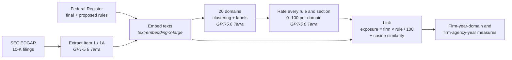

# Firm Regulatory Exposure from 10-K and Federal Register Texts


Replication code for the measure described in the paper's Technical Appendix.

The code measures how strongly each federal regulation touches each firm in each year. Firms
and rules are described in one shared vocabulary of **20 data-driven regulatory domains**.
A firm is exposed to a rule when both score high on the same domain. Semantic similarity
between the two texts adds a second, finer signal.

Every step that reads text runs through the OpenAI API:

| Task | OpenAI API endpoint | Model |
| :--- | :--- | :--- |
| Locate and clean Item 1 / Item 1A | `POST /v1/responses` | **GPT-5.6 Terra** |
| Name the 20 clusters | `POST /v1/responses` | **GPT-5.6 Terra** |
| Rate every rule and 10-K section | `POST /v1/responses` | **GPT-5.6 Terra** |
| Embed every rule and 10-K section (3,072 dimensions) | `POST /v1/embeddings` | **text-embedding-3-large** |
| Optional batch mode for the three model steps | `POST /v1/files`, `POST /v1/batches`, `GET /v1/batches/{id}`, `GET /v1/files/{id}/content` | — |

---

## Contents

- [Quick start](#quick-start)
- [Pipeline](#pipeline)
- [Setup](#setup)
- [Running the steps](#running-the-steps)
- [How the code matches the Technical Appendix](#how-the-code-matches-the-technical-appendix)
- [Outputs](#outputs)
- [Reproducibility and traceability](#reproducibility-and-traceability)
- [Cost and scale](#cost-and-scale)
- [Choices to report in the paper](#choices-to-report-in-the-paper)
- [Repository layout](#repository-layout)

---

## Quick start

```bash
pip install -r requirements.txt
echo "sk-..." > OpenAI.key            # your OpenAI API key (git-ignored)
# in config.yaml, set sec.user_agent to "Your Name you@university.edu"

python run.py download-fr             # Federal Register rules   (resumable)
python run.py download-10k            # EDGAR 10-K filings       (resumable)
python run.py extract --limit 200     # pilot on 200 filings
python run.py all                     # everything, skipping finished items
```

Before the scoring step, `python run.py score --dry-run` estimates its cost (it needs the
domain labels, so run it after `domains`).

Check the code without an API key:

```bash
pytest -q                             # tests with a fake OpenAI client
```

---

## Pipeline



| # | Command | What it does | Uses | Writes to `data/` |
| :-: | :--- | :--- | :--- | :--- |
| 1 | `download-fr` | Every final and proposed rule, with full text, title, summary, date and agencies | Federal Register API | `interim/rules.parquet` |
| 2 | `download-10k` | One 10-K per firm-year (CIK × fiscal year) | SEC EDGAR | `interim/filings.csv` |
| 3 | `extract` | Locates and cleans Item 1 (Business) and Item 1A (Risk Factors) | GPT-5.6 Terra | `interim/sections.csv` |
| 4 | `embed` | Embeds every rule and every 10-K section | text-embedding-3-large | `interim/embeddings/` |
| 5 | `domains` | Clusters both corpora into 20 domains and names each one | k-means · GPT-5.6 Terra | `processed/domains/` |
| 6 | `score` | Rates every rule and every section on the 20 domains (0–100) | GPT-5.6 Terra | `processed/scores/` |
| 7 | `link` | Exposure, similarity, firm-year and firm-agency-year measures | — | `processed/exposure/` |

---

## Setup

**Requirements.** Python 3.10 or later.

```bash
pip install -r requirements.txt
```

**OpenAI API key.** Save your key in a file named `OpenAI.key` in the repository root, on one
line; `OPENAI_API_KEY=sk-...` also works. `.gitignore` excludes the file, so never force-add
it. If the file is missing, the code reads the `OPENAI_API_KEY` environment variable instead.

**SEC identity.** The SEC requires every client to declare a name and an email address. Set
`sec.user_agent` in `config.yaml`. The download step refuses to run with the placeholder.

Every other setting lives in [`config.yaml`](config.yaml).

---

## Running the steps

```bash
python run.py download-fr       # 1  Federal Register rules, full text
python run.py download-10k      # 2  EDGAR 10-K filings, one per firm-year
python run.py extract           # 3  Item 1 / Item 1A          (GPT-5.6 Terra)
python run.py embed             # 4  embeddings                (text-embedding-3-large)
python run.py domains           # 5  20 domains + labels       (GPT-5.6 Terra)
python run.py score             # 6  domain scores 0-100       (GPT-5.6 Terra)
python run.py link              # 7  exposure and firm-level measures
python run.py all               #    steps 1-7 in order
```

| Option | Applies to | Effect |
| :--- | :--- | :--- |
| `--limit N` | `extract`, `score` | Process only the first N items (pilot runs) |
| `--corpus rules\|sections` | `embed`, `score` | Run one corpus only |
| `--dry-run` | `score` | Count tokens and estimate cost; no API calls |
| `--config PATH` | all | Use another configuration file |

`python run.py endpoints` prints the OpenAI API endpoint and model each step uses with the
current configuration.

> **Resumable.** Every step can be stopped and re-run: finished items are skipped and failed
> model calls are retried.
>
> **Batch API.** Set `openai.use_batch: true` to send model requests through the OpenAI Batch
> API (lower price, results within 24 hours). Submitted batch ids are saved, so an
> interrupted run resumes polling instead of resubmitting.

**Tests.** `pytest -q` needs no API key; tiktoken downloads its tokenizer files once on first
use. The tests cover the text utilities, prompts and exposure arithmetic, and run every step
after the downloads end to end with a fake OpenAI client.

---

## How the code matches the Technical Appendix

| Appendix | What it says | Code |
| :--- | :--- | :--- |
| **Data · Regulations** | Every final and proposed rule, with full text (HTML), title, summary, date and agencies | `fedreg.py` (types `RULE`, `PRORULE`) |
| **Data · Firms** | Every 10-K as HTML, tied to a firm-year by CIK and fiscal year | `edgar.py` |
| **Extracting what firms do** | Business and Risk Factors; locating and cleaning is LLM-guided | `extract.py`, `prompts.EXTRACT_INSTRUCTIONS` |
| **20 data-driven domains** | Both corpora embedded; unsupervised clustering into 20 clusters; the model names each cluster | `embed.py`, `domains.cluster`, `domains.label` |
| **Rating scale** | 0–100: 0 / 1–20 / 21–40 / 41–60 / 61–80 / 81–100 | `prompts.SCORE_INSTRUCTIONS` (bands verbatim) |
| **Rating documents** | One document at a time, fixed instructions, all 20 domains | `score.py` |
| **Firms** | Business and Risk Factors rated separately; rate what the firm describes, not word counts or industry norms | `score.py`, `prompts.SCORE_INSTRUCTIONS` |
| **Regulations** | Full text; rate what the rule requires or proposes; agency name alone is not evidence | `score.py`, `prompts.SCORE_INSTRUCTIONS` |
| **Linking** | Rules published around that time; Exposure = Firm × Rule / 100 | `link.run` |
| **Semantic similarity** | text-embedding-3-large vectors; closer vectors mean closer meaning | `embed.py`, `link.py` |
| **Firm-level measures** | Pairs keep all 20 domain scores; sums and means by firm-year-domain; firm-agency-year | `link.run` |
| **Same instructions everywhere** | Identical instructions and settings for every document | one `SCORE_INSTRUCTIONS`; one reasoning effort per step |
| **Grounded in evidence** | Rate only what the document says; zero when evidence is absent | `prompts.SCORE_INSTRUCTIONS` |
| **Traceable** | Each score stored with the document it came from | `*_raw.jsonl` (see below) |

<details>
<summary><b>How extraction works</b></summary>

<br>

Each 10-K is converted to lines; inline HTML spans stay together and inline-XBRL headers are
dropped. GPT-5.6 Terra receives two lists:

- **Heading candidates** — numbered lines that may be headings.
- **Repeated lines** — short lines that occur several times in the filing.

For Item 1 and Item 1A it returns:

- **Status** — `present`, `not_applicable`, `incorporated_by_reference` or `absent`.
- **Start line** — the body heading where the section begins, never a table-of-contents entry
  or a cross-reference.
- **End line** — the heading of the next item.

It also lists which repeated lines are page headers, footers or page numbers. The code cuts
out each section and removes those lines. A located section shorter than
`extraction.min_section_chars` is marked `too_short` and is not scored.

</details>

---

## Outputs

```text
data/
├── raw/
│   ├── federal_register/
│   │   ├── metadata/<year>.jsonl          rule metadata from the Federal Register API
│   │   ├── html/<year>/<doc>.html         full text as published
│   │   └── text/<year>/<doc>.txt          full text as plain text
│   └── edgar/<cik>/                       10-K primary documents
├── interim/
│   ├── rules.parquet                      one row per rule
│   ├── filings.csv                        one row per firm-year
│   ├── sections.csv                       one row per firm-year and section
│   ├── sections/<cik>/                    <fiscal_year>_item1.txt, <fiscal_year>_item1a.txt
│   ├── extract_raw.jsonl                  every extraction answer
│   └── embeddings/                        rules_*.npy, sections_*.npy (+ id CSVs)
├── processed/
│   ├── domains/                           cluster_labels.csv, assignments.parquet
│   ├── scores/                            rule_scores.parquet, section_scores.parquet, *_raw.jsonl
│   └── exposure/                          pairs/, firm_year_domain.parquet, firm_agency_year.parquet
└── logs/
    ├── embeddings_requests.jsonl          every embedding request: endpoint, documents, tokens
    └── batches/                           Batch API state, for resuming
```

| File | Content |
| :--- | :--- |
| `interim/rules.parquet` | Rule number, title, summary, action, type, date, year, agencies, text path |
| `interim/filings.csv` | CIK, company, form, accession, filing and report dates, fiscal year, file path |
| `interim/sections.csv` | Section status, length, text path, SHA-256 |
| `processed/domains/cluster_labels.csv` | Cluster id, label, description, number of rules and sections |
| `processed/domains/assignments.parquet` | Each document's cluster and distance to its centroid |
| `processed/scores/rule_scores.parquet` | `document_number`, `d01` … `d20` (0–100) |
| `processed/scores/section_scores.parquet` | `cik`, `fiscal_year`, `section` (`item1` / `item1a`), `d01` … `d20` |
| `processed/exposure/pairs/fiscal_year=<t>.parquet` | Firm-rule pairs: `cos_sim`, `E_max`, `E_sum`, `d01` … `d20` |
| `processed/exposure/firm_year_domain.parquet` | `exposure_sum`, `exposure_mean`, `n_rules_positive`, `n_rules_window` |
| `processed/exposure/firm_agency_year.parquet` | `exposure_sum` per firm, year and issuing agency |

Domain keys `d01` … `d20` follow the cluster order in `cluster_labels.csv`; join on that file
for the domain names. Link firms to Compustat or CRSP through the CIK.

---

## Reproducibility and traceability

| What is recorded | Where |
| :--- | :--- |
| Model id, for every result | `config.yaml` → saved with each record |
| Prompt and schema version hash (`prompt_version`) | every raw JSONL record |
| SHA-256 of each scored text (`text_sha256`) | every scoring record |
| Every model answer, with endpoint, OpenAI response id (or batch id), usage and time | `interim/extract_raw.jsonl`, `processed/domains/label_raw.jsonl`, `processed/scores/rules_raw.jsonl`, `processed/scores/sections_raw.jsonl` |
| Every embedding request, with endpoint, documents, token count and time | `logs/embeddings_requests.jsonl` |
| Clustering seed | `domains.seed` |

- **Fixed settings.** Outputs are constrained to a JSON schema (structured outputs), and
  reasoning effort is fixed per step. With `store: false`, OpenAI does not keep responses
  for later retrieval.
- **Limits on exact reproduction.** Reasoning models are not fully deterministic, so repeated
  calls can differ slightly. To report robustness, re-score a random subsample: delete its
  lines from the raw JSONL and re-run `score`.

---

## Cost and scale

- **Estimate first.** `python run.py score --dry-run` counts the input tokens of every
  document still to be scored and prices them at `openai.price_per_million`. The defaults are
  GPT-5.6 Terra list prices ($2.50 per million input tokens, $15 per million output tokens);
  check current pricing before running. With `use_batch: true` the estimate applies the 50%
  Batch API discount.
- **Cheaper steps.** Embeddings cost far less than scoring. Extraction sends only heading
  candidates, not whole filings.
- **Disk.** A firm-year is typically paired with several thousand rules. The default
  `linking.store_pairs: positive` stores only pairs with positive exposure; the firm-year
  aggregates always use all pairs.

---

## Choices to report in the paper

The appendix describes these steps in general terms. The code implements them with the
settings below; all are configurable.

| Item | Setting in this code | Config key |
| :--- | :--- | :--- |
| Rules "published around that time" | Published in years t−2 to t for fiscal year t | `linking.window_years_before/after` |
| Firm score from two section profiles | Maximum of Business and Risk Factors | `linking.firm_profile` |
| Firm text vector for similarity | Unit-length mean of the two section vectors | `embed.firm_year_vectors` |
| Long texts, embedding | Chunks of at most 8,000 tokens; token-weighted mean | `embedding.max_tokens_per_chunk` |
| Long texts, scoring | Parts of at most 400,000 tokens; maximum over parts | `scoring.max_input_tokens` |
| Clustering | Spherical k-means on PCA-reduced (256-d) unit vectors, sample balanced across corpora | `domains.*` |
| Fiscal year | Calendar year of the 10-K period-of-report date | `sec.fiscal_year_rule` |
| 10-K forms | 10-K, 10-K405, 10-KSB, 10-KT; no amendments; latest original per firm-year | `sec.forms`, `sec.include_amendments` |
| Joint rules in agency totals | Split equally across issuing agencies | `linking.agency_allocation` |

> **After `run.py domains`**, check that the appendix's 20-row domain table matches
> `data/processed/domains/cluster_labels.csv`.

---

## Repository layout

```text
regexposure/
├── run.py                        command-line entry point for every step
├── config.yaml                   all settings: models, data, steps
├── requirements.txt
├── OpenAI.key                    your API key (git-ignored, never committed)
│
├── regexposure/
│   ├── settings.py               config loader and data paths
│   ├── llm.py                    OpenAI API: endpoints, structured outputs, Batch API, embeddings
│   ├── prompts.py                every prompt and output schema, with version hashes
│   ├── textutil.py               HTML to text, tokens, chunking, hashing, JSONL store
│   │
│   ├── fedreg.py                 step 1   Federal Register download
│   ├── edgar.py                  step 2   EDGAR 10-K download, firm-year assignment
│   ├── extract.py                step 3   Item 1 / Item 1A location and cleaning
│   ├── embed.py                  step 4   text-embedding-3-large
│   ├── domains.py                step 5   clustering, cluster labels
│   ├── score.py                  step 6   domain scoring
│   └── link.py                   step 7   exposure, similarity, aggregation
│
└── tests/
    ├── test_core.py              text utilities, prompts, exposure arithmetic
    └── test_pipeline_offline.py  end-to-end run with a fake OpenAI client
```
